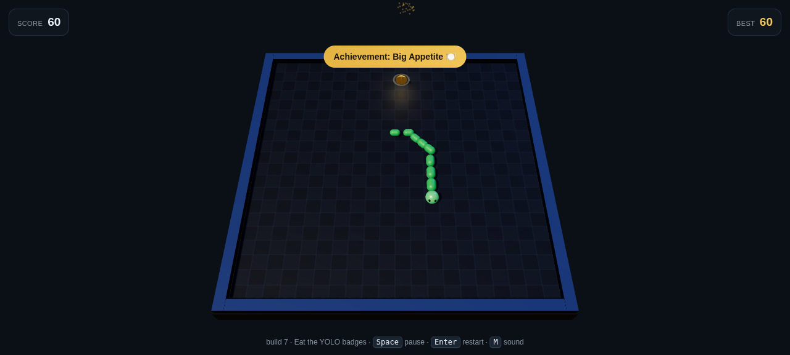

# Snake Yolo 3D

Eat the **YOLO** achievement badges: every one eaten makes the snake longer and the pace faster.



## Run it

1. Unzip the folder.
2. Open `index.html` from the **unzipped** folder.

The page loads `js/` and `vendor/` from the folder it sits in, so the folder has to stay together. Opening
`index.html` straight from inside the archive — a preview window, an un-unzipped folder — leaves those
folders out of reach; the page then says so instead of sitting there silently.

No server, no build step, no internet.

## Play

- **Arrows** or **WASD** — move
- **Space** or **P** — pause
- **Enter** — start, play again, or restart mid-run
- **M** — sound on/off
- On a phone: swipe on the board, or use the on-screen arrows

The record is kept in `localStorage` and survives a reload — some browsers block storage for pages opened as
local files; the game still plays, only the record will not persist. Every few badges the game awards one of
its own — Snack Attack, Big Appetite, Unstoppable, Apex, Legend — and then the set starts over as
`Snack Attack x2`, `Big Appetite x2` and so on, for as long as you keep eating.

## How it is put together

```
index.html              markup, HUD, the order in which the scripts load
js/config.js            tunables: grid, speeds, points, achievements

js/core/                the match itself — pure rules, knows nothing about three.js
  grid.js               board helpers
  snake.js              movement, growth, collisions
  world.js              food, score, pace, game over, record, event queue
  loop.js               fixed-step logic, rendered frames, interpolation factor

js/render/              everything that talks to three.js
  theme.js              the palette
  layout.js             grid cell -> world position
  stage.js              renderer, camera, lights, shadows
  board.js              the slab, the tiled top, the walls
  snakeView.js          capsule segments, sliding motion, head with eyes
  badgeView.js          the gold medallion, its halo, the particle burst

js/ui/                  hud.js, input.js, audio.js
js/main.js              composition root: builds the app, drains events, runs the loop

vendor/three.min.js     three.js r160 (MIT), the classic build
```

**Why the split is where it is.** `js/core/*` never touches three.js: the snake is cells on a grid, the world
is a match with a score and an event queue. `js/render/*` reads that state and draws it, `js/ui/*` owns the
DOM and the keyboard, and `js/main.js` is the only place that knows all of them. So the rules change without
touching the look, the look without touching the rules, and the rules can be reasoned about without a browser
at all.

**Why three.js is the classic build.** A page opened as a local file cannot load ES modules — modules are
fetched, and `file://` blocks that — while plain `<script>` tags are not fetched. That is why the game runs
from a double click with no server.

## How it is drawn

- one shadow-casting key light plus a hemisphere fill and a blue rim light, ACES tone mapping, fog for depth;
- the snake is a chain of capsules that slide between cells instead of jumping, with the body tapering to the
  tail and the head turning to face its direction of travel;
- the badge is a gold medallion that bobs, spins and lights the board with its own point light, and bursts
  into additive particles when eaten;
- sound is synthesised with WebAudio — the project carries no audio files.

## License

MIT — see [LICENSE](LICENSE). The bundled three.js is MIT as well — see `vendor/three.LICENSE.txt`.
